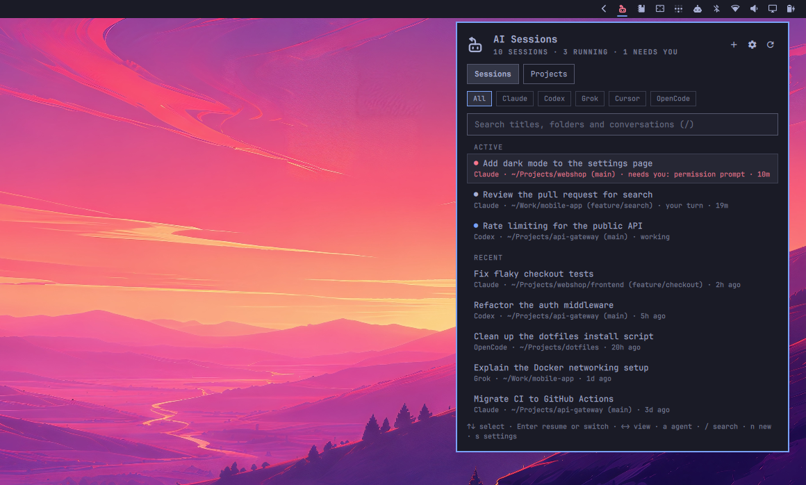
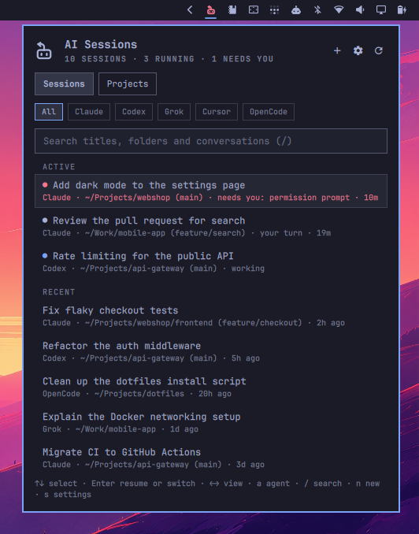
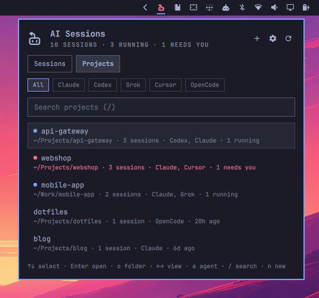
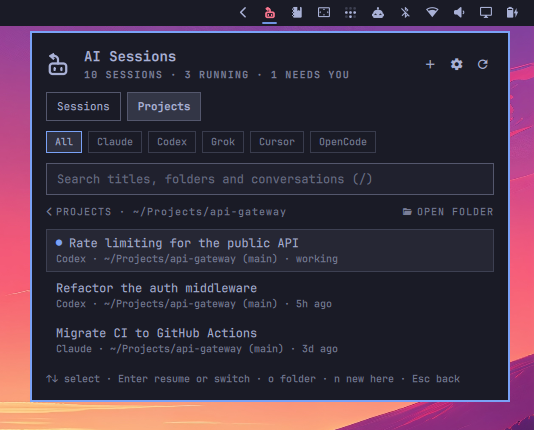
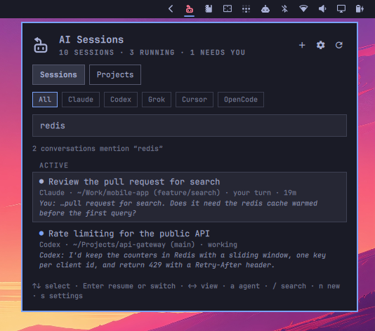
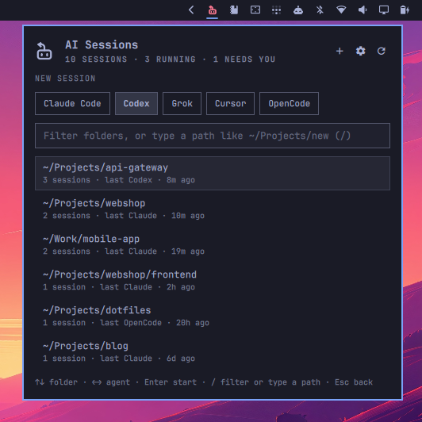
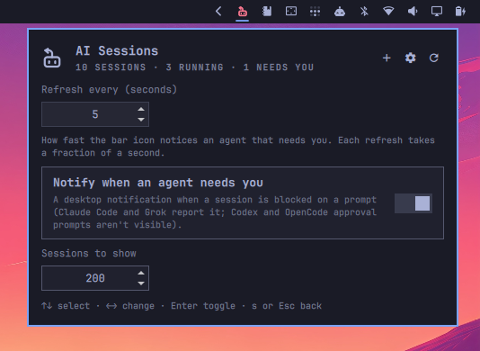
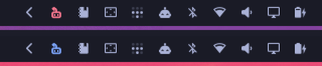

# omAiSessions

Every coding-agent conversation on this computer, in one Omarchy bar panel.



Claude Code, Codex, Grok, Cursor and OpenCode keep their history per folder: to
resume a conversation you have to remember where you started it and launch the
agent there. omAiSessions lists them all, from every folder, newest first. Pick
one and it opens a terminal in that conversation's folder with the agent already
resuming it. While agents run, the bar icon tells you whether one is working or
waiting on you.

## Features

- Two views, **Sessions** and **Projects**, and a row of agent chips (All,
  then each agent with sessions) that narrows either one
- Running sessions are pinned at the top under **Active**: what needs you
  first, then what's done, then what's working
- Projects: sessions grouped by git repository (subfolders and worktrees
  count as the repository) or by folder outside git, across every agent;
  `Enter` opens one, `n` starts a new session there, `o` opens its folder
- Sessions that are open right now show what they're doing: **working**,
  **needs you** (blocked on a permission or a question, with the reason) or
  **your turn** (done), and for how long
- The bar icon takes the accent color while agents run and the urgent color
  while one needs you; opening the panel then lands on that session, so
  Enter switches straight to its window
- A desktop notification when an agent starts waiting on you (once per wait,
  however many monitors run the bar); clicking it opens the panel on that
  session
- Picking a running session switches to its window instead of opening a
  second copy (two copies writing one session would corrupt it)
- Start a new session (`n`): pick any folder an agent has worked in, or type
  a path, and an installed agent (the one you used there last, by default)
- Titles from the agent's own naming (`/rename`, AI titles, Codex thread
  names, Grok, Cursor and OpenCode titles), falling back to your first prompt
- Folder, git branch and last activity for each session; sessions whose folder
  was deleted are flagged
- Search across titles and folders as you type, and inside the conversations
  themselves (what you typed and what the agent answered) once you pause:
  sessions that mention it follow, with the words around the match
- Keyboard-first: works without touching the mouse

## Screenshots

The sessions and folders in these screenshots are demo data.

| | |
|---|---|
|  |  |
| **Sessions.** Running sessions under Active, needs-you first; everything else below, newest first. | **Projects.** Sessions grouped by repository, with the agents used there and what's running. |
|  |  |
| **Inside a project.** Its sessions from every agent; `n` starts a new one there, `o` opens the folder. | **Search.** Titles and folders as you type; after a pause, the conversations that mention the words, with the excerpt. |
|  |  |
| **New session.** Any folder an agent has worked in, or a path you type, with the agent you used there last. | **Settings.** Refresh interval, notifications and how many sessions to show, saved to your bar config. |



The bar icon: urgent while an agent needs you (top), accent while agents work
(bottom), the bar's normal color otherwise.

## Keys

| Key | Action |
|---|---|
| `↑` `↓` / `j` `k` | Select a session |
| `←` `→` / `h` `l` | Sessions / Projects |
| `a`, `1`–`9` | Next agent chip / pick a chip (`1` is All) |
| `Enter` | Resume in a terminal, or switch to it if it's running |
| `/` | Search titles, folders and conversations (Esc clears, ↓ back to the list) |
| `r` | Refresh |
| `Enter` on a project | Its sessions, from every agent (`Esc` back, `n` new session there) |
| `o` on a project | Open its folder in the file manager |
| `n` | New session: `↑↓` folder, `←→` agent, `/` filter or type a path, `Enter` start |
| `s` | Settings (refresh interval, notifications, sessions shown) |
| `Esc` | Close |

## Settings

Press `s` (or the gear) in the panel. Changes are saved to your bar config
(`~/.config/omarchy/shell.json`) right away.

| Setting | Default | |
|---|---|---|
| Refresh every | 5 s | How fast the icon notices an agent that needs you; each refresh takes about 0.1 s |
| Notify when an agent needs you | on | One desktop notification per wait |
| Sessions to show | 200 | |

## Requirements

- Omarchy 4 (the shell with plugin support)
- `python3` (standard library only), `xdg-terminal-exec`, `hyprctl` and
  `xdg-open`; `uwsm-app` and `omarchy-notification-send` are used when present.
  All of them ship with Omarchy.
- Any of the agents, installed and on the shell's `PATH`: `claude`, `codex`,
  `grok`, `cursor-agent`, `opencode`. Agents that aren't installed are still
  listed; only resuming needs the binary.

## Install

```bash
omarchy plugin add https://github.com/ramoncardena/omaisessions --enable
```

The widget lands in the bar's right section. To open it with a key, add a
binding to `~/.config/hypr/bindings.lua` (`SUPER + A` is free in Omarchy's
defaults):

```lua
o.bind("SUPER + A", "AI sessions", "omarchy-shell shell toggle io.github.ramoncardena.omaisessions")
```

## Remove

```bash
omarchy plugin remove io.github.ramoncardena.omaisessions --yes
rm -r ~/.cache/omaisessions   # the cache it leaves behind
```

Removing (or disabling) the widget also drops its settings from
`~/.config/omarchy/shell.json`. Agent history is never touched.

## How it works

`bin/omaisessions` (Python, standard library only) reads each agent's history
and prints JSON for the panel:

| Agent | History | Resume | Running |
|---|---|---|---|
| Claude Code | `~/.claude/projects/*/<id>.jsonl` (or `$CLAUDE_CONFIG_DIR`) | `claude --resume <id>` | `~/.claude/sessions/<pid>.json` |
| Codex | `~/.codex/sessions/YYYY/MM/DD/rollout-*.jsonl` (or `$CODEX_HOME`) | `codex resume <id>` | a `codex` window, matched to the sessions `codex app-server` holds locks for |
| Grok | `~/.grok/sessions/<folder>/<id>/summary.json` (or `$GROK_HOME`) | `grok --resume <id>` | `~/.grok/active_sessions.json` |
| Cursor | `~/.cursor/chats/<md5 of folder>/<id>/store.db` (or `$CURSOR_CONFIG_DIR`) | `cursor-agent --resume <id>` | process with the store open |
| OpenCode | `~/.local/share/opencode/opencode.db` (or `$XDG_DATA_HOME`) | `opencode --session <id>` | `opencode --session <id>`, or the newest session in its folder |

What a running session is doing comes from the agent's own records:

| Agent | Working / your turn | Needs you |
|---|---|---|
| Claude Code | `status` in `~/.claude/sessions/<pid>.json` | `waitingFor` there (permission prompt, dialog, input) |
| Codex | `task_started` / `task_complete` in the rollout | not recorded: approval prompts read as working |
| Grok | `turn_started` / `turn_ended` in the session's `events.jsonl` | `permission_requested` there |
| OpenCode | the latest message's completion in `opencode.db` | not recorded: permission prompts read as working |
| Cursor | not recorded: shown as running | |

Cursor names each chat's directory after an md5 of its folder, so the folder
is recovered by matching that hash: against paths inside the chat, then the
folders other agents know about, then your home directory a few levels deep.
A hash that can't be matched (the folder was deleted or moved) is remembered
for an hour, so the home walk doesn't repeat on every refresh. OpenCode keeps
every session in one SQLite database, which also holds its login tokens; only
the session, message and part tables are read.

Registry entries are checked against the live process (pid and start time),
so a crashed agent never shows as running. A session you just started has no
history until its first prompt, so there is nothing to resume yet; while it
runs it is listed as "New session", so you can still switch to its window.

Searching inside conversations (`omaisessions search <words>`) reads the
transcripts when you search, after a short pause in typing. A session matches
when every word starts a word somewhere in it, in a message you typed or the
agent's answer; tool calls, tool output, injected context and Claude's
compaction summaries are skipped. The query as a phrase ranks first, then
the words in order, then all of them in one message. Nothing is indexed or
stored: each search scans again (about 0.3 s for 50 MB of history).

It only reads history; it never changes it. Results are cached in
`~/.cache/omaisessions/` by file mtime, so a refresh only re-reads files that
changed. Terminals open with the same app-id as `omarchy agent`
(`org.omarchy.agent`), so your window rules for agents apply.

These history formats are internal to each agent and can change between
versions; each agent has its own small reader, so a format change breaks only
that tab.

## Privacy and security

Omarchy plugins run unsandboxed, as you, inside the shell. This is
everything omAiSessions touches, so you can check it before enabling it.

**Reads**
- The agents' history folders listed above. Only the session list, titles,
  first prompts and folders are extracted, except when you search inside
  conversations: then the messages are read to find the words, and only
  the matching sessions and a short excerpt reach the panel. The excerpt is
  shown, never stored. OpenCode's database also holds its login tokens; only
  its `session`, `message` and `part` tables are queried, read-only.
- `/proc`, to tell which sessions are running: for your own processes only,
  each one's command line, working folder, start time and open file paths.
  For `codex` processes only, the environment is read to find `CODEX_HOME`
  (it can hold API keys; only `CODEX_HOME` and `HOME` are used, and nothing
  from it is kept or shown).
- Your home folder's directory names, up to three levels deep, only to match
  a Cursor chat to its folder.

**Writes**
- `~/.cache/omaisessions/index.json` (mode `600`): the extracted titles and
  first prompts, plus which Cursor chat folders could not be found, so a
  refresh doesn't re-read unchanged files or walk your home folder again.
- `~/.cache/omaisessions/notified.json` and `notify.lock`: which waits were
  already announced, so each one notifies once.
- Its own settings in `~/.config/omarchy/shell.json`, through the shell,
  when you change them.

Agent history is never modified.

**Runs**
- Your terminal via `xdg-terminal-exec` (through `uwsm-app` when present),
  with the agent's own resume command when you pick a session, or the bare
  agent command when you start a new one (in a folder that must exist).
- `hyprctl`, to find and focus a running session's window.
- `xdg-open` on a project folder, when you ask to open it (only a folder
  that exists, never a file).
- `omarchy-notification-send` (or `notify-send` elsewhere), when an agent
  starts waiting on you, if enabled. Its click action is
  `omarchy-shell shell summon` for this panel, passed as data, never a shell
  string. The text is escaped, since notifications render markup, and handed
  over as plain values: a title can't become an option or a hint.

Every command is an argument list, never a shell string. Session ids must
match a strict pattern before they reach a command line, a session opens in
the folder its own history records (never one with control characters in
its name), and titles are shown as plain text. A history file in a shape the
readers don't expect skips that session instead of breaking the list. There
is no network access.

Resuming runs the agent in the session's folder, so that folder's project
settings apply, exactly as when you resume it by hand; each agent's own
folder-trust prompts still apply. Titles can be written by the agent's model
from what it read, so treat them as labels, not as trusted text.

## IPC

```bash
omarchy-shell io.github.ramoncardena.omaisessions toggle   # open | close | refresh
```

`refresh` reaches the widget on every monitor.

## Development

```bash
scripts/dev-sync.sh    # validate, copy into ~/.config/omarchy/plugins, enable
tests/run.sh           # helper tests against fixture histories; nothing real is touched
mkdir -p /tmp/qslint && ln -sfn "$OMARCHY_PATH/shell" /tmp/qslint/qs
/usr/lib/qt6/bin/qmllint -I /tmp/qslint BarWidget.qml Panel.qml SessionIcon.qml
```

The screenshots above come from demo histories built for them, so they can be
retaken without anyone's real sessions.

## License

MIT
